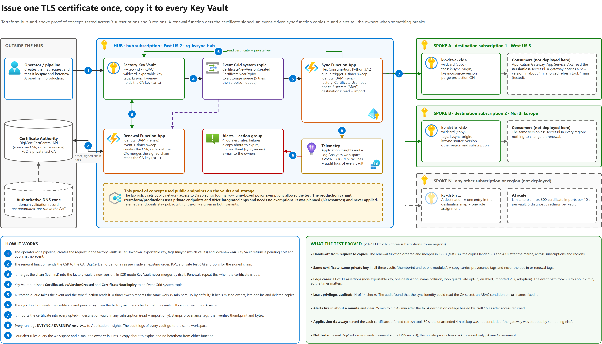
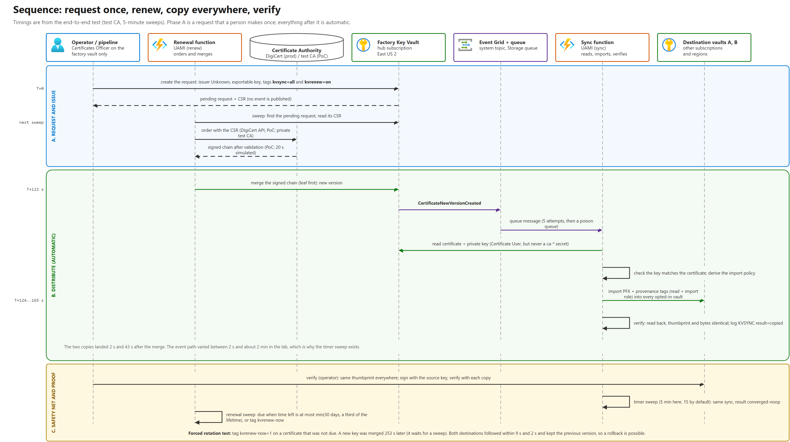
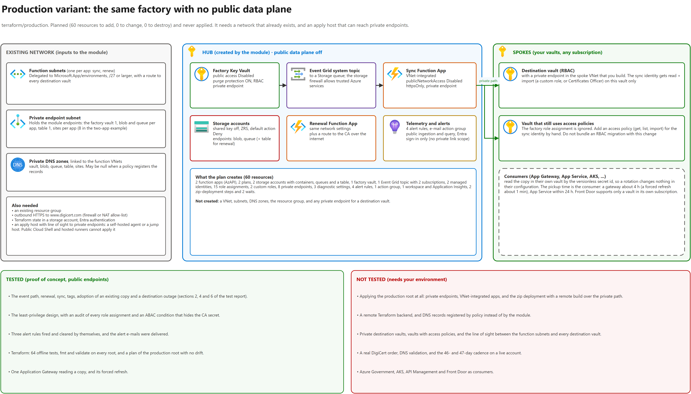

# Key Vault certificate factory

Request or renew a TLS certificate **once**, in one Azure Key Vault, and have a copy appear in the Key Vaults of other subscriptions, regions and teams. Nobody else has to order the certificate again.

> **Status: a tested proof of concept, not production software.** It was tested in a lab with a private test CA, **not** with a real certificate authority. The DigiCert client has never talked to DigiCert. The private-network (production) variant was deployed **once**, from the ARM template, in a lab; its Terraform twin was planned and validated but **never applied**. Read [What was and was not tested](#what-was-and-was-not-tested) before you rely on any of it. This is an unofficial sample, not a Microsoft product, with no support and no warranty ([LICENSE](LICENSE)).

## The problem

Key Vault has no "copy this certificate to another vault" call. Backup and restore work only inside one subscription and one geography. Key Vault's integrated DigiCert issuer covers OV and EV certificates only, so a DV or wildcard certificate needs the certificate-signing-request (CSR) route, where Key Vault never merges or renews anything by itself. In an estate with many vaults, each team ends up ordering the same certificate again.

## How it works



1. **One factory vault** (the "source") holds the certificate. It is created either by Key Vault's integrated CA (OV, EV) or as a CSR that the **renewal function** orders from a CA, merges and renews (DV, wildcard, any CA with an API).
2. Every new version of a certificate raises a Key Vault event. Event Grid puts it on a Storage queue and the **sync function** copies the version, **with its private key**, into each destination vault named in the certificate's `kvsync` tag.
3. A **timer sweep** (15 minutes by default) repeats the same idempotent work. The event is the speed-up; the sweep is the guarantee, and it also picks up tag changes, which fire no event.
4. Each consumer (Application Gateway, App Service, AKS, a virtual machine) reads the copy from **its own vault** through the versionless URI, so nothing in that subscription needs a role on the factory.
5. Every outcome is one `KVSYNC result=...` or `KVRENEW result=...` log line in Log Analytics. Three alert rules watch for failures, for a copy that is about to expire, and for a function that stopped.

The copy never deletes, never overwrites a certificate it does not own, and never copies a copy. See [DESIGN-QA.md](docs/DESIGN-QA.md) for why it is built this way, including one vault versus several, managed versus user-assigned identities, and what to harden.

The same flow as a sequence, with the timings of the end-to-end test (a test CA, a five-minute sweep):



## What is in this repository

| Path | What it is |
|---|---|
| `terraform/modules/hub` | The factory: source vault, two Flex Consumption function apps (sync and renew), Event Grid, queues, logging, alerts, least-privilege roles |
| `terraform/poc` | A root that builds a **public** proof of concept with two destination vaults in two other subscriptions and regions, plus an optional Application Gateway as a test consumer |
| `terraform/production` | A root for a **private-network** deployment (private endpoints, VNet-integrated apps, no public data plane) that adopts your existing network and vaults. Planned and validated only |
| `terraform/modules/app_gateway` | An Application Gateway that serves a certificate from a vault, used to test a consumer |
| `deploy/poc`, `deploy/production` | The same two deployments as **ARM templates**: the Bicep source (`main.bicep`) and the compiled `azuredeploy.json` that the Deploy to Azure buttons open |
| `deploy/modules` | The Bicep modules both templates share: factory, function app, destination access, roles, private endpoint |
| `deploy/packages` | The two function apps as ready-to-deploy zips, built reproducibly from `src/` (`scripts/build_packages.py --check` proves it). The templates deploy them |
| `deploy/production/examples` | A minimal landing zone (VNet, subnets, private DNS zones) for trying the production template in an empty subscription |
| `src/sync`, `src/renew` | The two Python functions |
| `scripts/inventory_vaults.py` | Read-only inventory of an estate's vaults and certificates, with a report of certificates that cover the same names in more than one vault |
| `scripts/make_testca.py`, `scripts/build_packages.py` | Puts a private test CA into the factory vault (an ARM template cannot generate a key pair), and builds the function packages |
| `examples/` | A CSR policy for a wildcard and a worksheet for planning a rollout |
| `tests/` | 113 offline tests (including a check that every Markdown link and anchor resolves, and that every Deploy to Azure button opens a template that is committed here) and the live test scripts used for the lab results |
| `docs/` | Design, operations, runbook, test report, certificate authorities, prior art, and `docs/diagrams` (the draw.io source and PNGs of the architecture, the sequence and the production variant) |

## Try it (public proof of concept)

This builds real, billed resources in up to three subscriptions of **one tenant** (they may be the same subscription three times). Use a sandbox. About US$8 a month at list price if left running ([estimate](docs/OPERATIONS.md#cost)). There are two routes to the same thing: an ARM template behind a **Deploy to Azure** button, and Terraform. [ARM template or Terraform?](#arm-template-or-terraform) compares them.

### Route 1: Deploy to Azure (ARM template)

[](https://portal.azure.com/#create/Microsoft.Template/uri/https%3A%2F%2Fraw.githubusercontent.com%2Fbrenmelo%2Fkv-cert-sync%2Fmain%2Fdeploy%2Fpoc%2Fazuredeploy.json)

The button opens [deploy/poc/azuredeploy.json](deploy/poc/azuredeploy.json), compiled from [deploy/poc/main.bicep](deploy/poc/main.bicep). It deploys at **subscription** scope because it creates three resource groups (the factory and two destination vaults). Every parameter has a default, so it can be deployed as it comes.

1. Press the button, sign in, pick the subscription and a **region that supports Flex Consumption**. The region you pick is the factory's region. You need Owner on every subscription you use.
2. Optional: `spokeASubscriptionId` and `spokeBSubscriptionId` move the destination vaults to other subscriptions of the tenant, `alertEmailAddresses` takes a JSON array of receivers, and `packageBaseUri` pins the function code (see the notes below).
3. When it has finished (3 min 35 s in the lab), put the test CA into the factory vault, because an ARM template cannot generate a key pair: `pip install azure-identity azure-keyvault-secrets cryptography`, `az login`, then `python scripts/make_testca.py --vault kv-src-<suffix>`. The suffix and the names of the three vaults are in the deployment's outputs.
4. Create a certificate request and watch the copies appear: [docs/CUSTOMER-RUNBOOK.md](docs/CUSTOMER-RUNBOOK.md), section 6. To run the live tests, save the outputs (`az deployment sub show --name <your deployment> --query properties.outputs > outputs.json`) and run `python tests/live/e2e.py --outputs outputs.json`.
5. Remove it: delete the three resource groups and the two custom roles ([docs/OPERATIONS.md](docs/OPERATIONS.md#removing-the-arm-proof-of-concept)). There is no `destroy`.

What to know first:

* **The function code is not in the template.** Each app pulls a zip from `packageBaseUri`, by default the `main` branch of this repository, which changes whenever the repository does. Pin it to a release tag or a commit, or host the two zips yourself.
* The deployment gives the person who starts it **Key Vault Administrator** on the three vaults and read access to the event queues, so that the live tests can run. That is for a proof of concept only. Set `operatorObjectId` and `operatorPrincipalType` when a service principal or a pipeline deploys.
* If an Azure Policy forces public network access off, or demands purge protection, create time-boxed policy exemptions on the three resource groups a few minutes **before** you press the button ([docs/OPERATIONS.md](docs/OPERATIONS.md#removing-the-arm-proof-of-concept)).
* Deploying again with the same `suffix` updates the same resources.

### Route 2: Terraform

You need: Terraform 1.9 or later (tested with 1.16.6), the Azure CLI signed in (`az login`; the module deploys the function code with `az functionapp deployment source config-zip`), and Owner on the three subscriptions (the permissions it really needs are in the [runbook, section 2.1](docs/CUSTOMER-RUNBOOK.md)). The providers are told not to register resource providers, so the ones listed in `terraform/poc/providers.tf` must already be registered.

```bash
cd terraform/poc
cp terraform.tfvars.example terraform.tfvars   # fill in the three subscription ids, a suffix, owner and your object id
terraform init
terraform apply
terraform output -json > outputs.json          # the live tests read this file
```

If your Azure Policy forces public network access off, the proof of concept needs a time-boxed waiver: see `policy_exemptions` in `terraform.tfvars.example`. Then create a certificate request and watch the copies appear: [docs/CUSTOMER-RUNBOOK.md](docs/CUSTOMER-RUNBOOK.md), section 6, or run `python tests/live/e2e.py --outputs outputs.json`. Remove everything with `terraform destroy` (the vault whose purge protection is on keeps its name reserved for the retention period).

Terraform cannot be opened from a button. The closest routes are Azure Cloud Shell, which has Terraform and your sign-in ready, and a GitHub Actions workflow ([.github/workflows/deploy-poc.yml](.github/workflows/deploy-poc.yml)). **Neither was run**; the commands above were run from a workstation.

### ARM template or Terraform?

Both build the same factory with the same settings, roles, alerts and event subscriptions; a comparison of the two live deployments found no difference except an empty list that one writes as `null`.

| | ARM template (`deploy/`) | Terraform (`terraform/`) |
|---|---|---|
| Start with | The button, `az deployment sub create`, or any ARM client | `terraform apply` from a workstation |
| Function code | Azure pulls a zip from `packageBaseUri` and builds it (a remote build) | `az functionapp deployment source config-zip` from your machine |
| Test CA | Loaded afterwards with `scripts/make_testca.py` | Created by Terraform |
| State | None. ARM records the deployment | A state file you must keep and protect |
| Removing it | Delete the resource groups and two custom roles | `terraform destroy` |
| Application Gateway as a test consumer | Not included | Optional module |
| Tested | Deployed from its raw GitHub URL; every live test passed | Every live test passed |
## Production

[docs/CUSTOMER-RUNBOOK.md](docs/CUSTOMER-RUNBOOK.md) is the step-by-step plan for an estate that already has vaults: inventory, a decision for every vault, deployment, a first certificate, onboarding in waves, consumer cut-over, rollback. Both production deployments adopt what you already have: **a resource group, a private-endpoint subnet, two subnets delegated to `Microsoft.App/environments`, the private DNS zones (or a central policy that registers them) and the resource ids of the destination vaults**. They create no network and no destination vault. About US$64 a month at list price, US$58 of it private endpoints ([estimate](docs/OPERATIONS.md#cost)).

[](https://portal.azure.com/#create/Microsoft.Template/uri/https%3A%2F%2Fraw.githubusercontent.com%2Fbrenmelo%2Fkv-cert-sync%2Fmain%2Fdeploy%2Fproduction%2Fazuredeploy.json)

* **ARM template** ([deploy/production](deploy/production)). It deploys at resource-group scope, so the button asks for the resource group. **Register the `Microsoft.App` resource provider in the subscription first** (`az provider register --namespace Microsoft.App --wait`). Without it the function apps retry for about 12 minutes and the deployment then fails with `ServiceAssociationLink ... Please check if 'Microsoft.App' is registered`. Azure Resource Manager deploys the function code, so no machine inside the network is needed for that: the platform pulls the two zips from `packageBaseUri` (pin it, or host the packages yourself; `deployCode=false` skips the code). It was deployed **once**, in a lab, on top of the sample landing zone in [deploy/production/examples](deploy/production/examples), with a private test CA ([test report](docs/TEST-REPORT.md#the-arm-template-production-private-network)). It cannot put your CA's API key into the private vault: the `nextSteps` output lists what is left to do.
* **Terraform** ([terraform/production](terraform/production)). Planned (60 resources to add) and **never applied**. With public access off, the machine that runs `terraform apply` must reach the function apps' private deployment endpoint, so use a self-hosted agent or a jump host inside the network. A public Cloud Shell or a GitHub-hosted runner cannot do it.


## What was and was not tested

Each result ran once, in a lab, on 20 and 21 October 2026. Details and times: [docs/TEST-REPORT.md](docs/TEST-REPORT.md).

| Area | Result |
|---|---|
| A certificate request is ordered, merged and copied to two other subscriptions and regions | **Pass.** Merged 122 s after the request; copies 43 s and 2 s after the merge. Same certificate, same private key |
| Forced rotation, idempotence, an opt-out | **Pass** |
| Eight edge cases: non-exportable key, tag selection, name collision, loop guard, late opt-in, disabled certificate, imported PFX, adoption | **Pass**, 11 of 11 assertions |
| Effective permissions of each identity on each vault | **14 of 14** after one real fix: the sync identity could read the CA credential, now stopped by an ABAC condition and proven with a probe |
| Adopting a destination certificate that Key Vault renews by itself, and a copy deleted in a destination | **Pass**, 15 of 15 in two runs. Adoption replaces the destination's policy, so Key Vault stops renewing it there. A deleted copy blocks only its own destination and raises the `failures` alert while it stays deleted |
| Three alerts | All **fired and cleared by themselves**. They take 26 to 31 minutes (failures) to about 1 h 45 min (expiring) to clear, by design |
| A destination outage | Healed by itself 160 s after access returned. The `failures` alert fired 56 s after the first failure line, because the outage lasted past one sweep. An outage shorter than that heals without an alert |
| Application Gateway reading a copy | Served the vault's certificate. A forced refresh took 60 s. Unattended pickup was **not concluded** (the gateway was stopped by something outside the test) |
| **A real CA order (DigiCert or any other)** | **Not tested.** The largest gap |
| Domain validation (DCV) for the CA | **Not built** |
| The private-network production stack | **Planned and validated only** |
| Azure Government, AKS, API Management, Front Door, other tenants | Not tested |
| More than three vaults and about ten certificates | Not tested |

## Certificate lifetimes keep getting shorter

Under CA/Browser Forum ballot SC-081v3 the maximum validity of a public TLS certificate falls from 398 days to 200 days (15 March 2026), 100 days (15 March 2027) and 47 days (15 March 2029). DigiCert publishes 199, 99 and 46 days. The renewal function renews when the time left is down to the smaller of 30 days and a third of the lifetime, so a 46-day certificate is renewed 15 days before expiry. A simulated year of daily sweeps renewed a 46-day certificate 11 times and it never came closer than 16 days to expiry. At that cadence **domain validation is the step that will need automating**, and it is not built here. See [docs/CERTIFICATE-AUTHORITIES.md](docs/CERTIFICATE-AUTHORITIES.md).

## Documentation

| Document | For |
|---|---|
| [docs/CUSTOMER-RUNBOOK.md](docs/CUSTOMER-RUNBOOK.md) | Rolling the factory out across an existing estate, step by step |
| [docs/DESIGN-QA.md](docs/DESIGN-QA.md) | Why it is built this way: identities, one vault or several, resilience, security, alerting, Application Gateway, Deploy to Azure |
| [docs/OPERATIONS.md](docs/OPERATIONS.md) | Settings, tags, log lines, queries, alerts, cost, routine jobs, troubleshooting |
| [docs/TEST-REPORT.md](docs/TEST-REPORT.md) | What was run, what happened, what went wrong, what was not tested |
| [docs/REQUIREMENTS-COVERAGE.md](docs/REQUIREMENTS-COVERAGE.md) | A checklist of what an organization might ask for, and what this does and does not cover |
| [docs/CERTIFICATE-AUTHORITIES.md](docs/CERTIFICATE-AUTHORITIES.md) | DigiCert versus others, prices, validity rules, what to test with |
| [docs/PRIOR-ART.md](docs/PRIOR-ART.md) | What Microsoft and the community already provide, and the gap this fills |

## Safety notes

* By default (`destination_role_mode = "custom"`) the sync identity can only **read and import** certificates in a destination: no delete, purge, backup or restore. It cannot read the CA credential either: secrets whose names start with `ca-` are refused by an ABAC condition.
* Copies carry the private key. A destination vault's owner can export it, so copy only to vaults whose owners you trust with the key, and keep `kvsync` write access to the factory vault tight (a tag on a factory certificate chooses where its key goes).
* Never put a CA API key on a command line or in a variable file. Store it as a secret in the factory vault whose name starts with `ca-`.
* Test in a sandbox first. Nothing here removes or purges what it did not create.

## Notices

* The diagrams in `docs/diagrams` (the PNGs and the draw.io source) use the Azure architecture icons. Those icons belong to Microsoft and are used under Microsoft's [icon terms](https://learn.microsoft.com/azure/architecture/icons/), which allow them in architecture diagrams, training material and documentation. They are **not** covered by this repository's MIT license, so do not reuse them for anything else.
* Product and company names (Azure, DigiCert, GlobalSign, GitHub, Terraform, AWS and others) belong to their owners. They are used only to describe what this sample works with.
